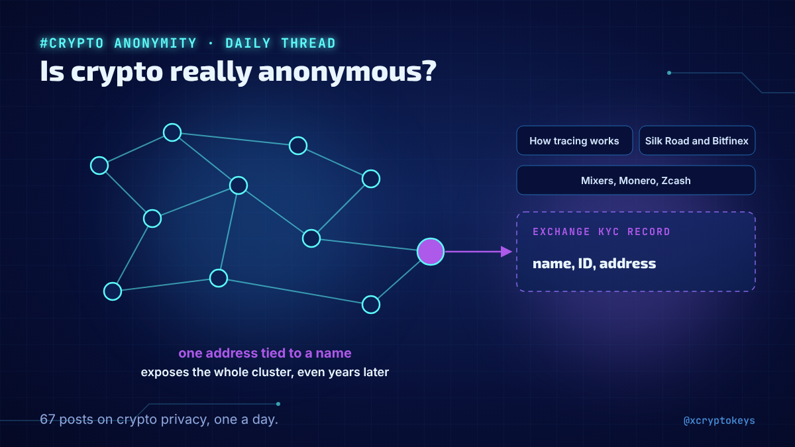
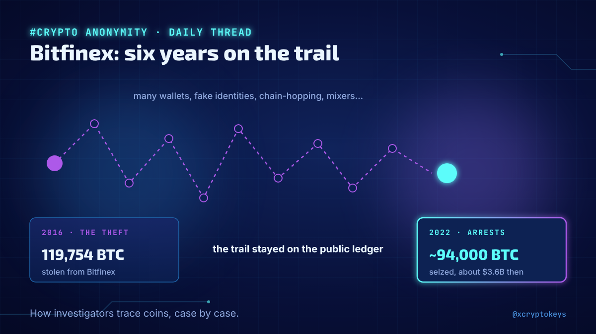
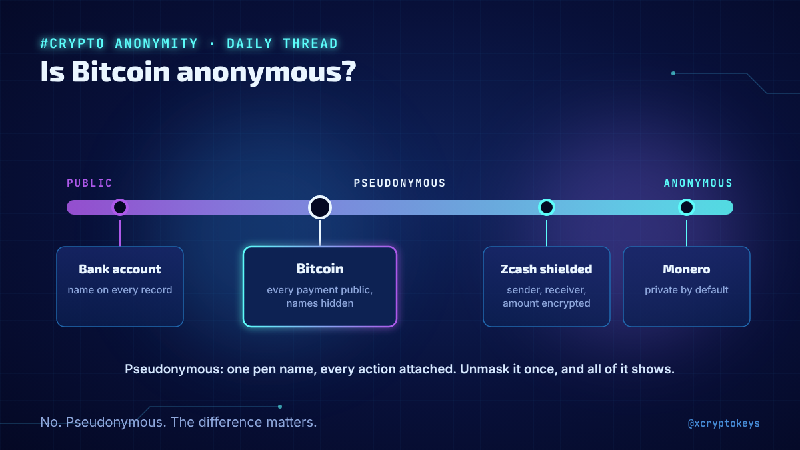
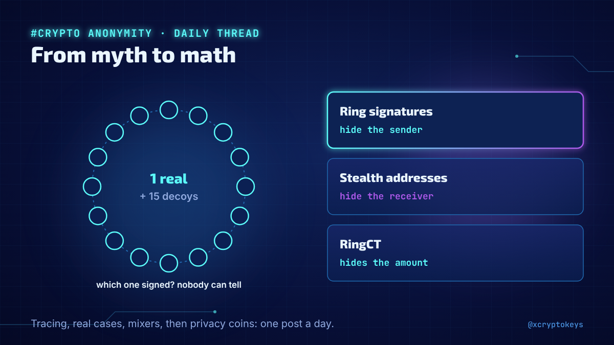
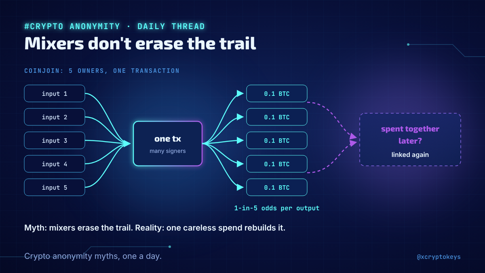

# Accroches anonymity-001

Réponses à coller à la main sous un post populaire du même sujet, avec l'image qui va avec. Fichier généré par `design/card.py --hooks` depuis `hooks.json` : modifier le JSON, pas ce fichier. Règles dans `STYLE.md` (section Accroches).

## 1



```text
Is crypto anonymous? New daily thread on how blockchain tracing really works, how Silk Road and Bitfinex coins were followed for years, and what mixers, Monero and Zcash actually hide. 67 posts. #XCKano1
```

203 caractères

## 2



```text
How did investigators trace Bitfinex coins for years? Why did Tornado Cash end up in court? What does Monero hide that Bitcoin doesn't? I'm covering one question like these every day in a new thread. #XCKano1
```

208 caractères

## 3



```text
Is Bitcoin anonymous? No, it's pseudonymous, and the difference matters. My new daily thread shows how addresses get linked to people, and what real privacy takes. #XCKano1
```

172 caractères

## 4



```text
How tracers link addresses, the cases they cracked, the mixers and their trials, then Monero and Zcash: I started a daily thread on privacy in crypto, from myth to math. #XCKano1
```

178 caractères

## 5



```text
Bitcoin is anonymous, mixers erase the trail, privacy is only for criminals: three myths my new daily thread takes apart, with real cases and the actual techniques. #XCKano1
```

173 caractères
