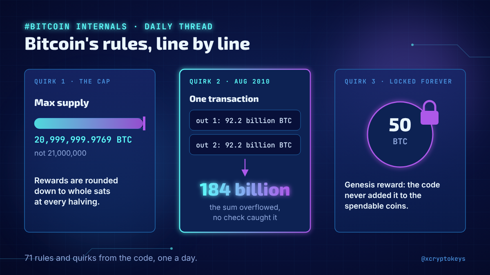
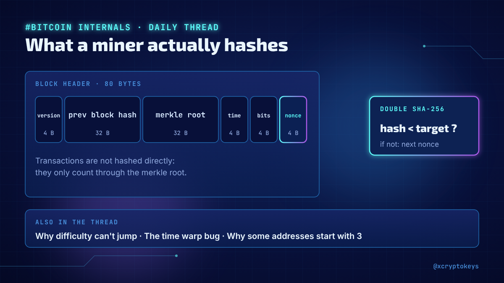
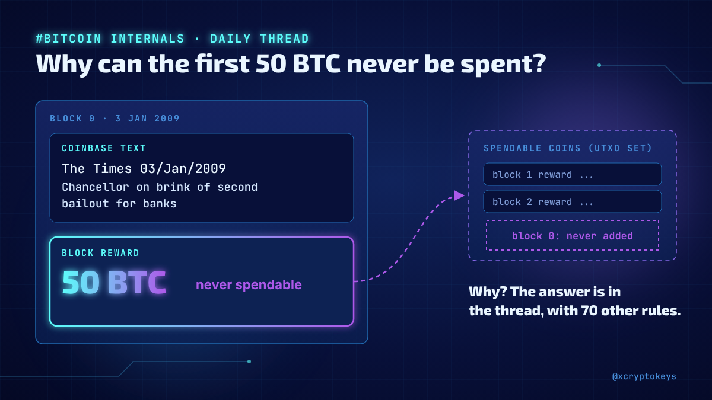
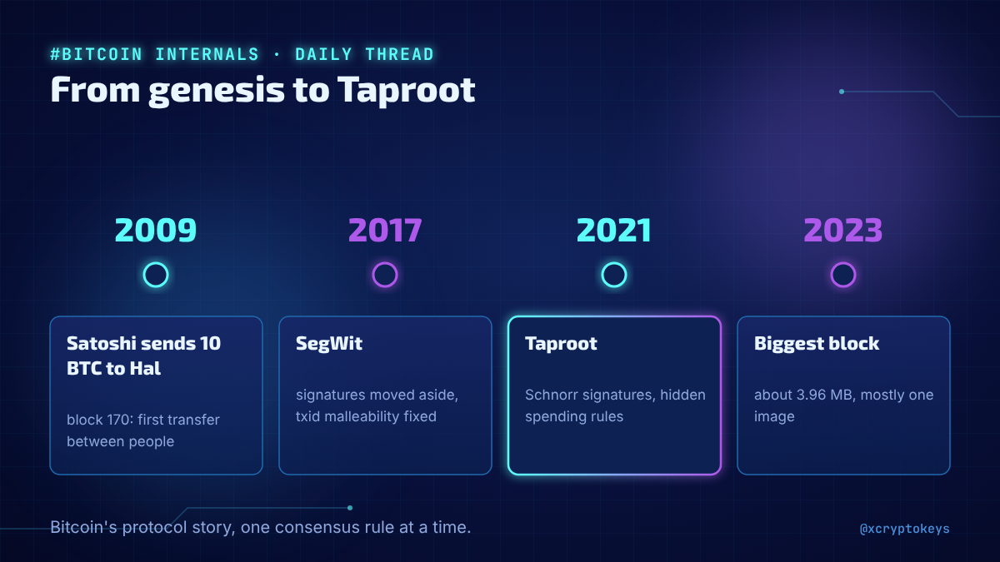
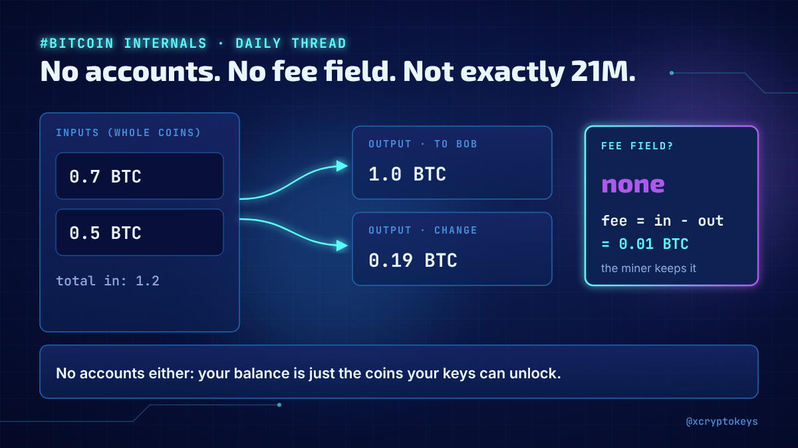

# Accroches bitcoin-001

Réponses à coller à la main sous un post populaire du même sujet, avec l'image qui va avec. Fichier généré par `design/card.py --hooks` depuis `hooks.json` : modifier le JSON, pas ce fichier. Règles dans `STYLE.md` (section Accroches).

## 1



```text
Starting a daily thread on Bitcoin's real rules, straight from the code: why the 21M cap isn't exact, the 2010 bug that minted 184 billion BTC, coins nobody can ever spend. 71 posts, one a day. Worth a follow if you hold BTC. #XCKbtc1
```

234 caractères

## 2



```text
Ever wondered what a miner actually hashes, why difficulty can never jump wildly, or why some addresses start with 3? I'm answering one question like that every day in a new thread on Bitcoin's internals. #XCKbtc1
```

213 caractères

## 3



```text
The first Bitcoin block holds a newspaper headline, and its 50 BTC reward can never be spent. Do you know why? My new daily thread goes from the genesis block to Taproot, one protocol rule at a time. #XCKbtc1
```

208 caractères

## 4



```text
From Satoshi's first transfer to Hal, through SegWit and the biggest block ever (mostly one image), to Taproot: I'm telling Bitcoin's protocol story one rule a day in a new thread. #XCKbtc1
```

189 caractères

## 5



```text
Most people assume Bitcoin has accounts, a fee field and an exact 21M cap. It has none of them. I started a daily thread on how Bitcoin really works under the hood, one rule a day. #XCKbtc1
```

189 caractères
