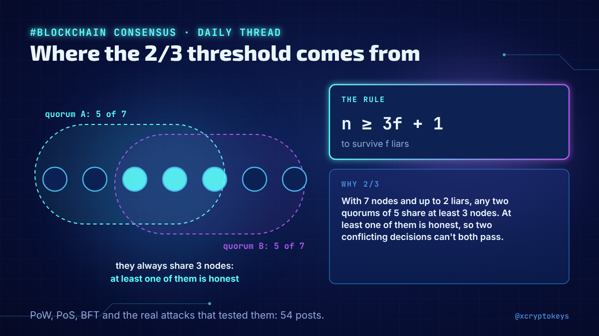
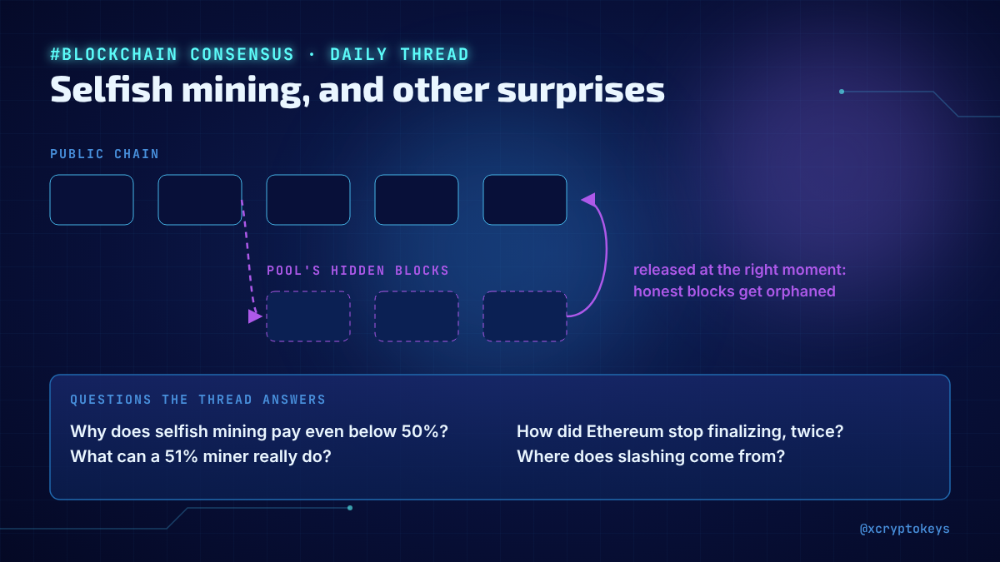
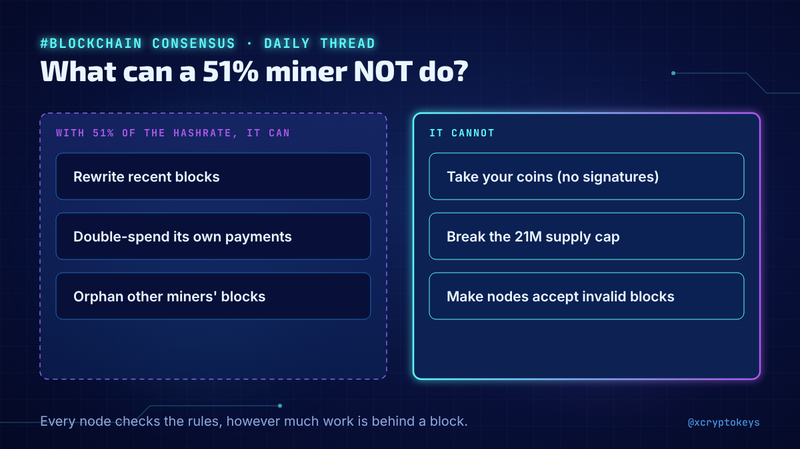
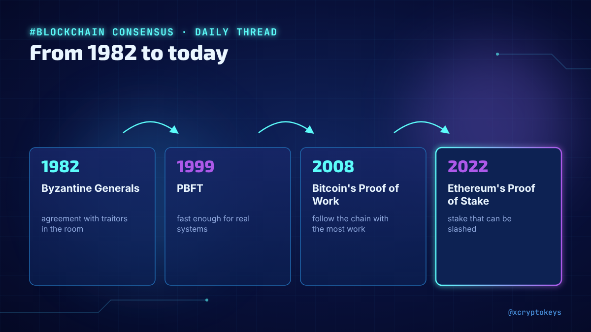
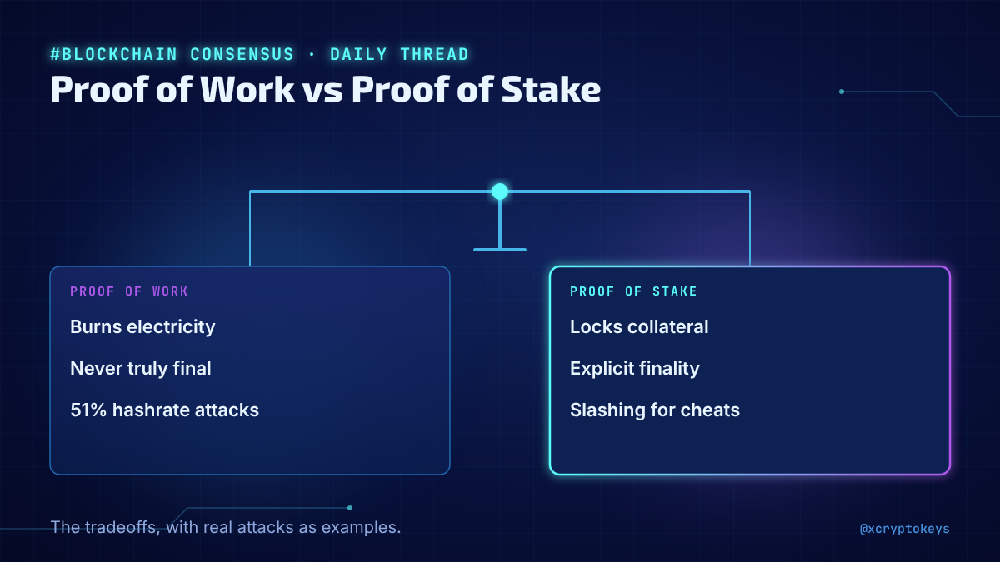

# Accroches consensus-001

Réponses à coller à la main sous un post populaire du même sujet, avec l'image qui va avec. Fichier généré par `design/card.py --hooks` depuis `hooks.json` : modifier le JSON, pas ce fichier. Règles dans `STYLE.md` (section Accroches).

## 1



```text
New daily thread on how blockchains agree without a boss: Proof of Work, Proof of Stake, BFT, and the real attacks that tested them, like Bitcoin Gold's 51% attacks or Ethereum losing finality twice. 54 posts, one a day. #XCKcns1
```

229 caractères

## 2



```text
What can a miner with 51% really do? Why does selfish mining pay even below 50%? How did Ethereum stop finalizing, twice? I'm answering one consensus question like these every day in a new thread. #XCKcns1
```

205 caractères

## 3



```text
What can an attacker with 51% of the hashrate actually do, and what can't they? Spoiler: less than most people think. One of 54 posts in my new daily thread on blockchain consensus. #XCKcns1
```

190 caractères

## 4



```text
From the 1982 Byzantine Generals paper to Bitcoin's Proof of Work, Ethereum's Proof of Stake and the BFT chains: I started a daily thread on how strangers agree on one history. #XCKcns1
```

185 caractères

## 5



```text
PoW vs PoS debates often skip the tradeoffs: electricity vs collateral, slow certainty vs explicit finality, 51% attacks vs slashing. I started a daily thread that lays them out, with real attacks as examples. #XCKcns1
```

218 caractères
