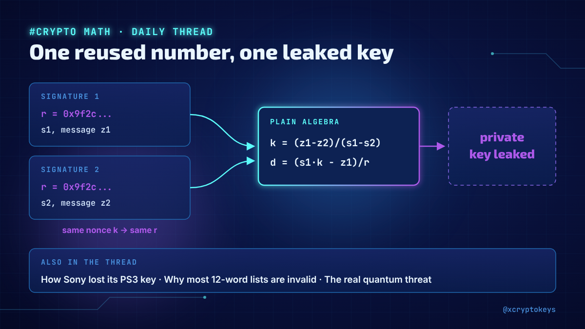
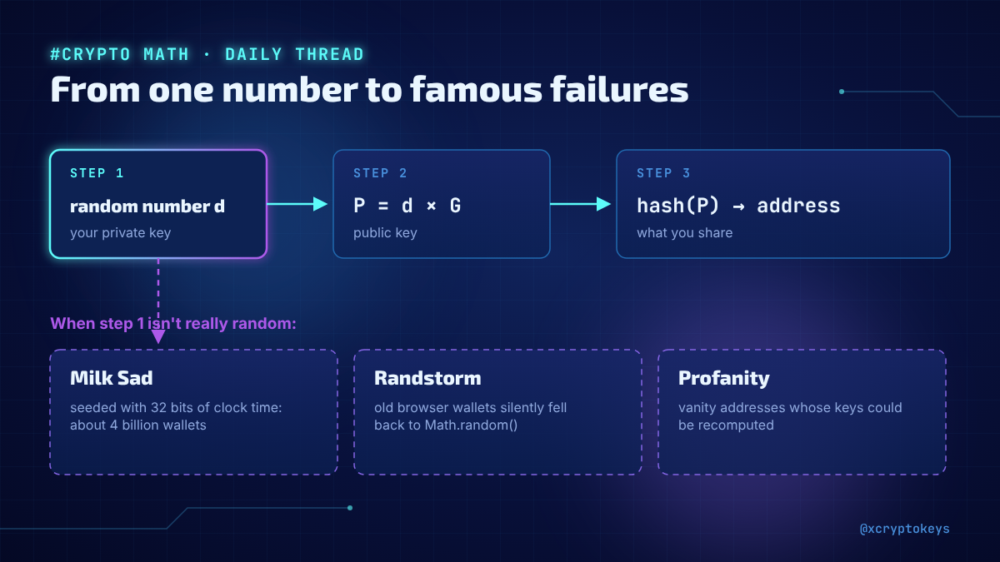
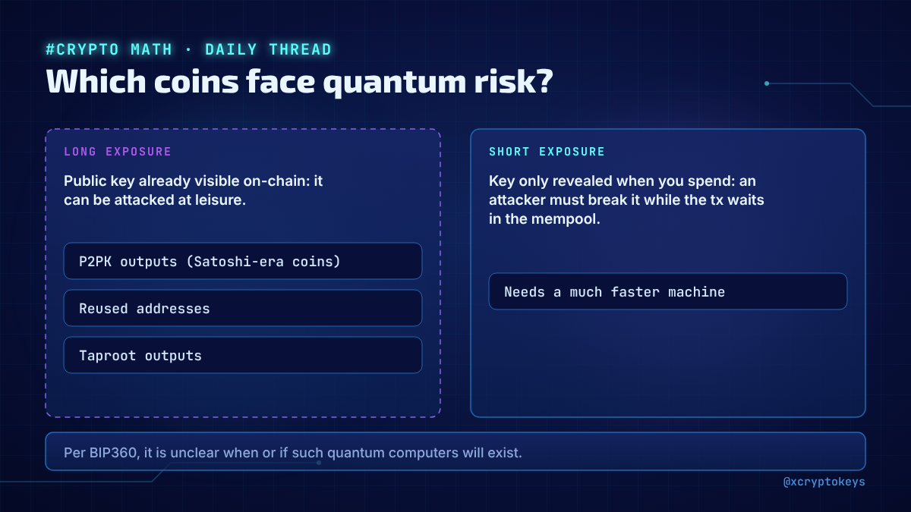
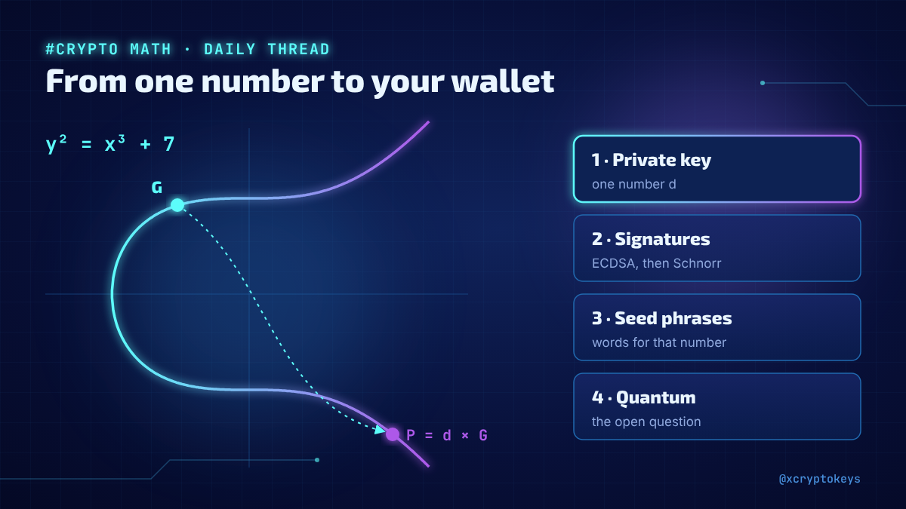
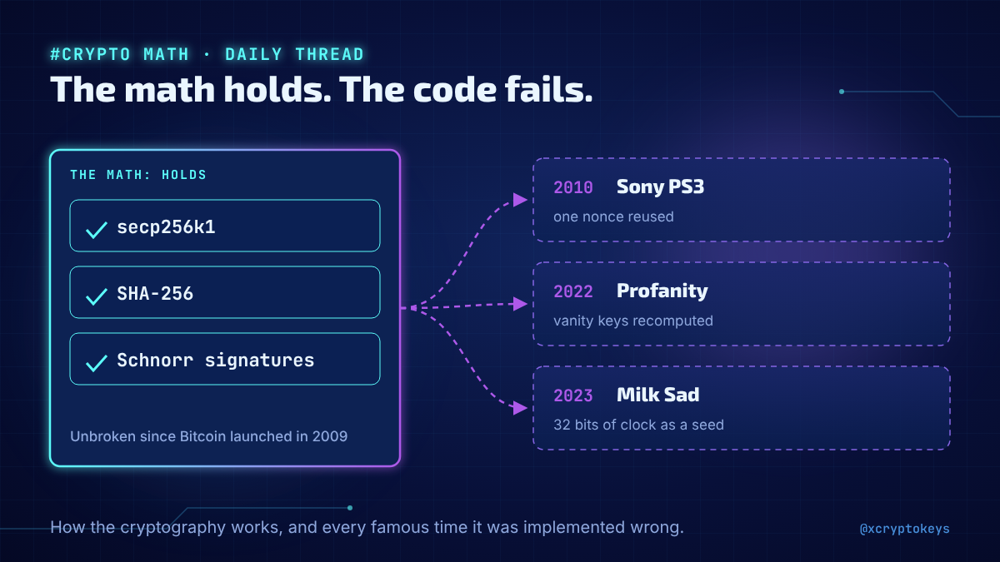

# Accroches crypto-math-001

Réponses à coller à la main sous un post populaire du même sujet, avec l'image qui va avec. Fichier généré par `design/card.py --hooks` depuis `hooks.json` : modifier le JSON, pas ce fichier. Règles dans `STYLE.md` (section Accroches).

## 1



```text
New daily thread on the math that guards your coins: how one reused number leaked Sony's PS3 key, why most random 12-word phrases are invalid, and what quantum computers really threaten. 76 posts, no math degree needed. #XCKcry1
```

228 caractères

## 2



```text
Signatures, hashes, seed phrases, and the real failures: Android's broken randomness, Milk Sad, vanity addresses gone wrong. I'm explaining the cryptography behind crypto one fact a day in a new thread. #XCKcry1
```

211 caractères

## 3



```text
Could a quantum computer steal your bitcoin? Not all coins face the same risk, and quantum-safe signatures already exist. That's where my new daily thread on crypto math ends. It starts with y^2 = x^3 + 7. #XCKcry1
```

214 caractères

## 4



```text
From a single number (your private key) to signatures, Schnorr, seed phrases and the quantum question: I started a daily thread on the cryptography that protects every wallet. #XCKcry1
```

184 caractères

## 5



```text
The math behind Bitcoin has held up since 2009. The code around it hasn't always. My new daily thread covers both: how the cryptography works, and the famous times it was implemented wrong. #XCKcry1
```

198 caractères
