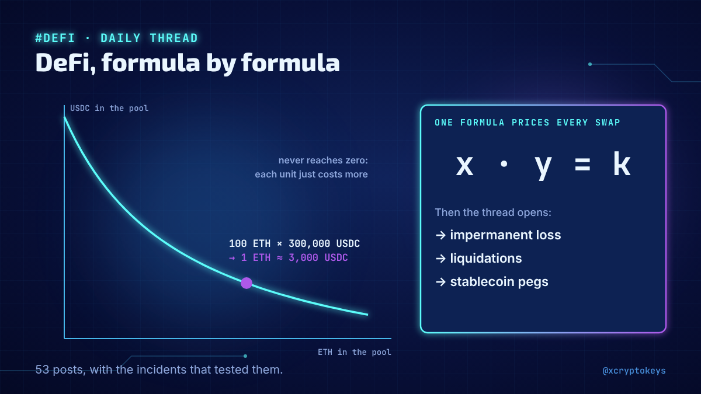
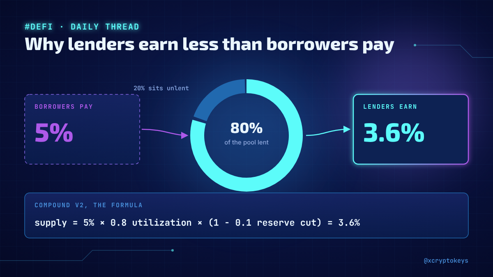
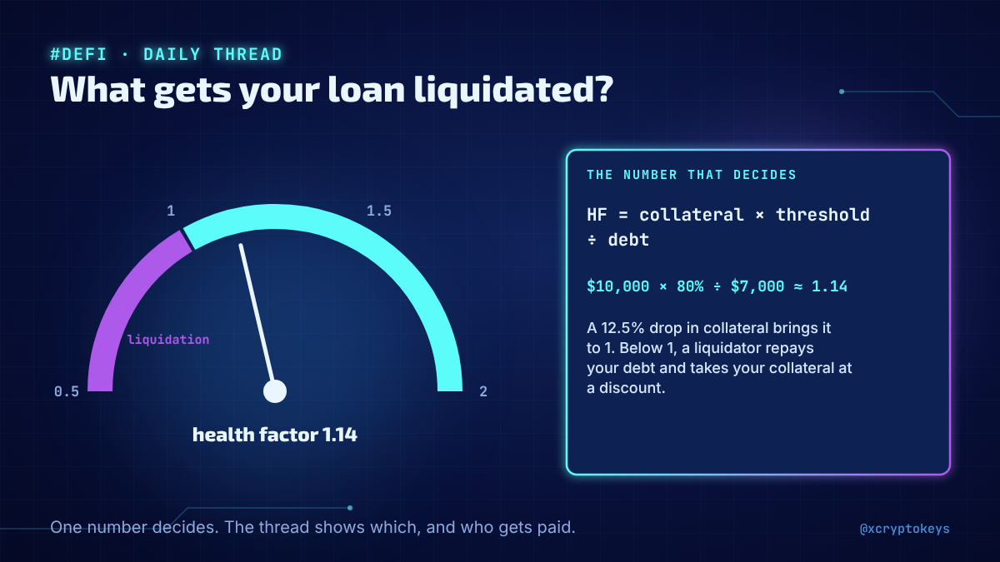
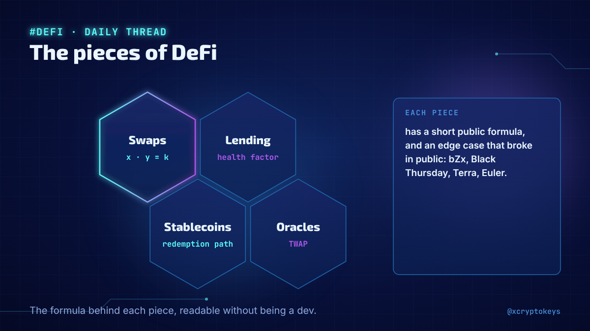
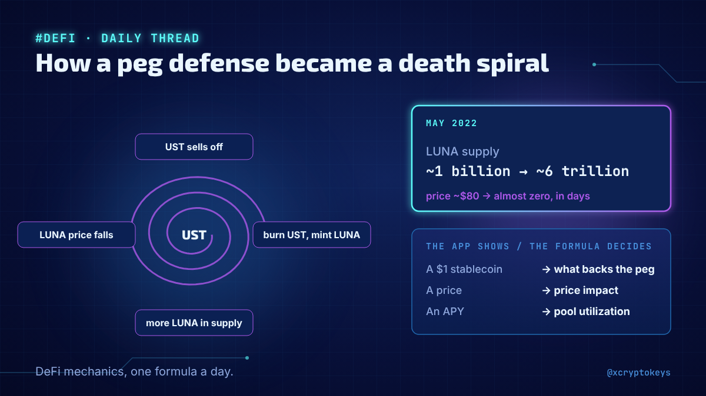

# Accroches defi-001

Réponses à coller à la main sous un post populaire du même sujet, avec l'image qui va avec. Fichier généré par `design/card.py --hooks` depuis `hooks.json` : modifier le JSON, pas ce fichier. Règles dans `STYLE.md` (section Accroches).

## 1



```text
New daily thread on the formulas behind DeFi: how a DEX prices swaps, where impermanent loss comes from, what triggers a liquidation, how a peg can spiral. 53 posts, each with the incident that tested it. #XCKdfi1
```

213 caractères

## 2



```text
Why can a pool never run dry? Why do lenders earn less than borrowers pay? How did a peg defense become a death spiral? One DeFi formula like these every day in my new thread. #XCKdfi1
```

184 caractères

## 3



```text
One number decides whether your DeFi loan gets liquidated, and someone gets paid to do it. My new daily thread explains formulas like this one, from swaps to stablecoins. #XCKdfi1
```

179 caractères

## 4



```text
Swaps, then lending, then stablecoins, oracles and vaults: I started a daily thread opening the formula behind each piece of DeFi, readable without being a dev. #XCKdfi1
```

169 caractères

## 5



```text
The app shows a price, an APY, a dollar. Behind each one is a formula with edge cases, and some broke in public: the bZx attack, Black Thursday, Terra. I'm opening them one a day in a new DeFi thread. #XCKdfi1
```

209 caractères
