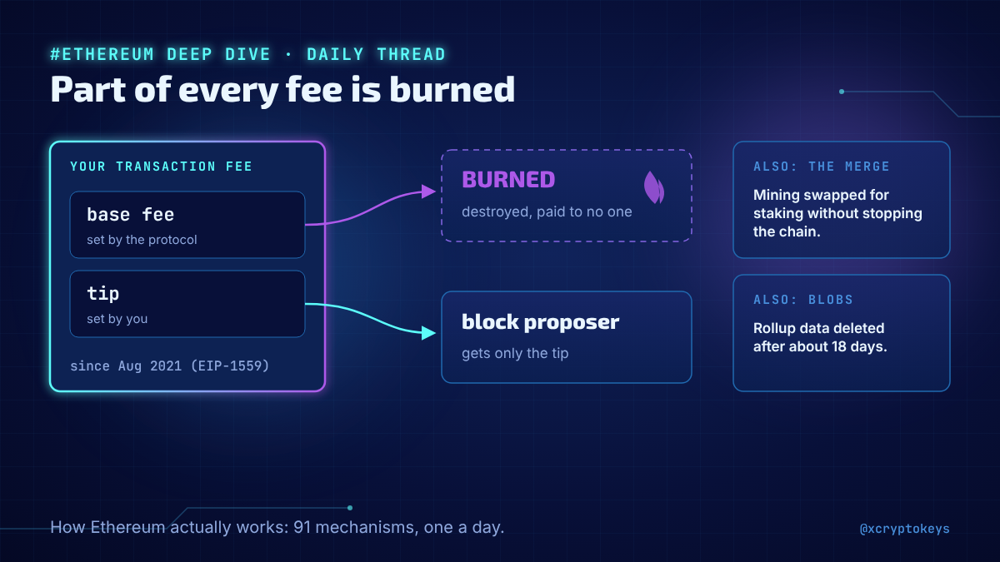
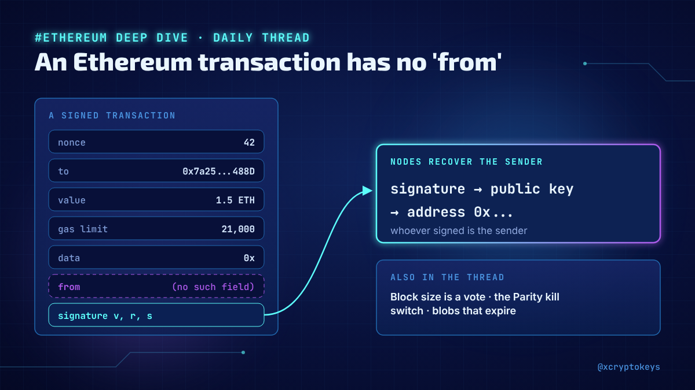
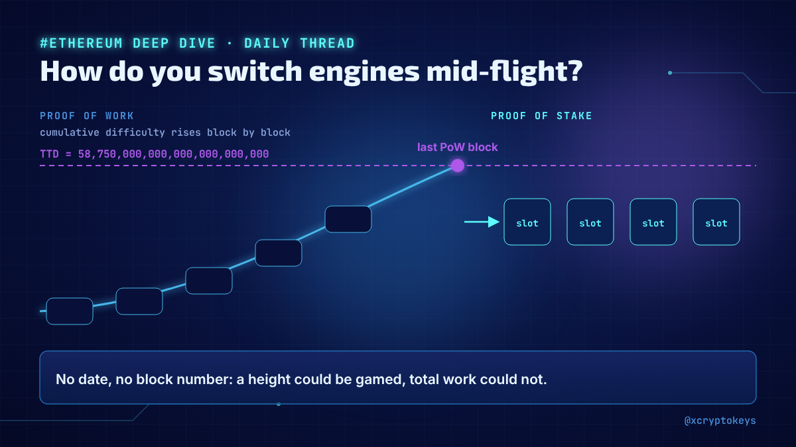
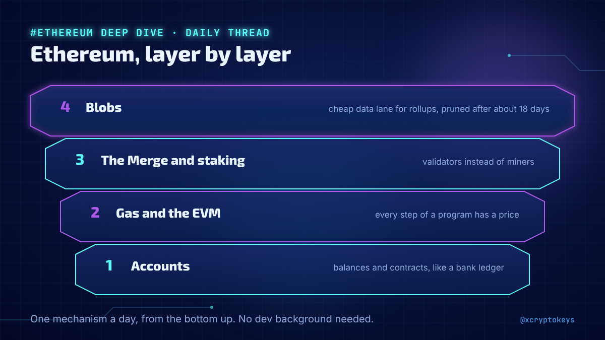
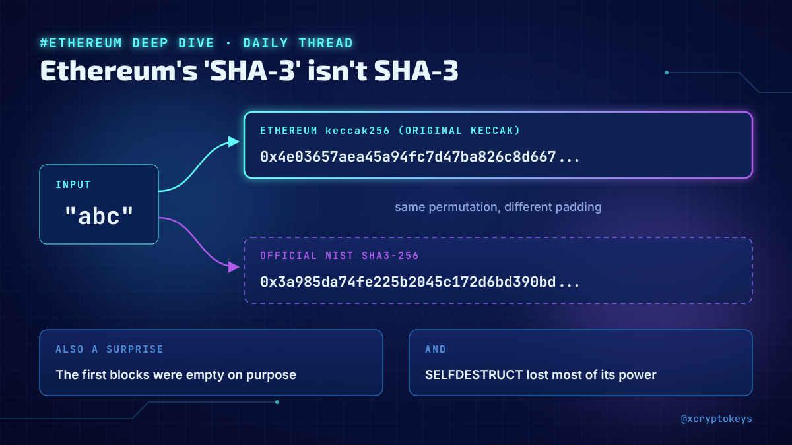

# Accroches ethereum-001

Réponses à coller à la main sous un post populaire du même sujet, avec l'image qui va avec. Fichier généré par `design/card.py --hooks` depuis `hooks.json` : modifier le JSON, pas ce fichier. Règles dans `STYLE.md` (section Accroches).

## 1



```text
New daily thread on how Ethereum actually works: why part of every fee is burned, how the Merge swapped engines without stopping, what blobs are and why they get deleted. 91 posts, written for non-devs. #XCKeth1
```

211 caractères

## 2



```text
Ever asked why an Ethereum transaction has no 'from' field, why block size is a vote, or how one user froze the Parity wallets? My new daily thread opens Ethereum's hood one mechanism at a time. #XCKeth1
```

203 caractères

## 3



```text
How did Ethereum switch from mining to staking with no date and no block number set in advance? That's one of 91 mechanisms in my new daily thread, from accounts and gas to blobs. #XCKeth1
```

188 caractères

## 4



```text
Accounts, then gas and the EVM, then the Merge and staking, then blobs: I'm walking through Ethereum one mechanism a day in a new thread. No dev background needed. #XCKeth1
```

172 caractères

## 5



```text
Ethereum's 'SHA-3' isn't SHA-3, its first blocks were empty on purpose, and SELFDESTRUCT lost most of its power. Little surprises like these fill my new daily thread on how Ethereum really works. #XCKeth1
```

204 caractères
