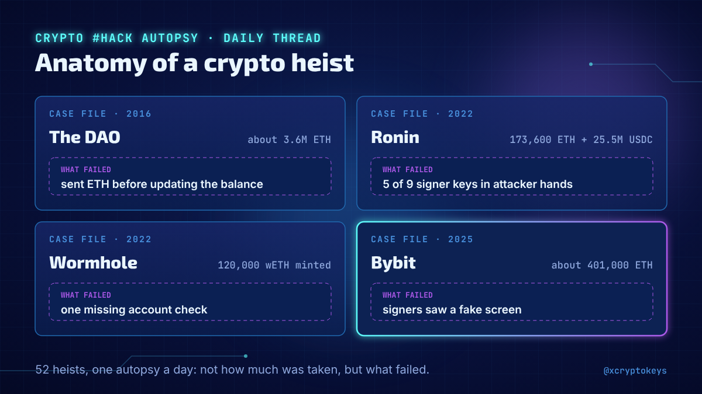
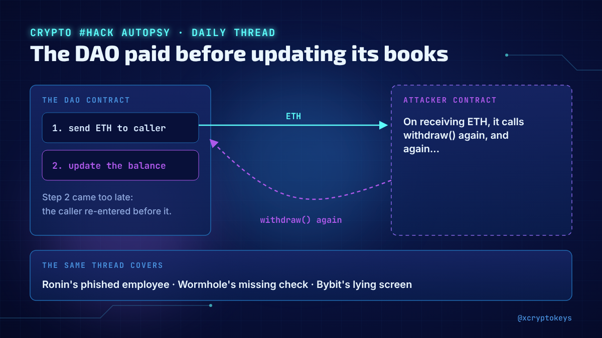
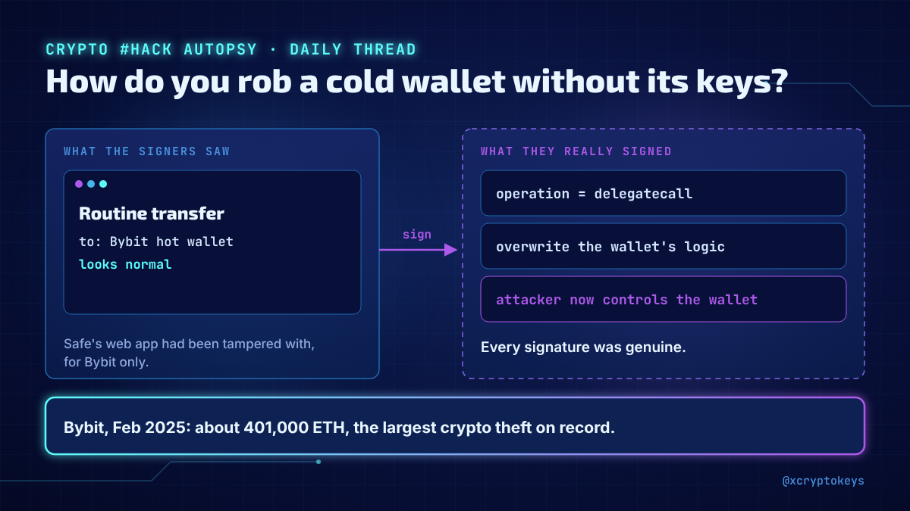
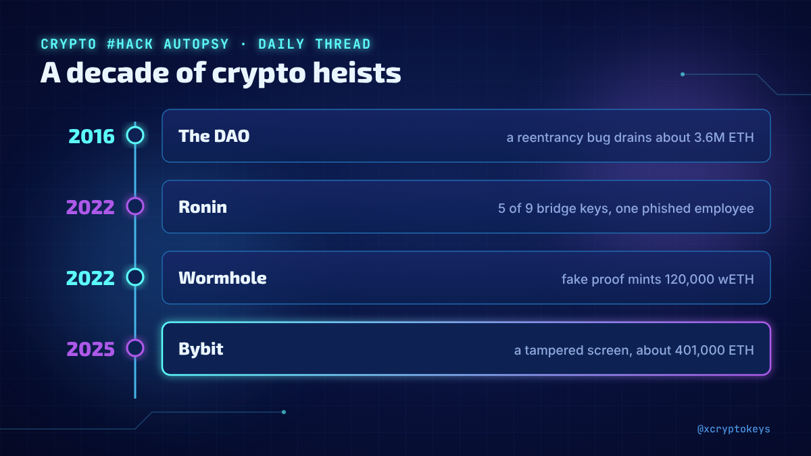
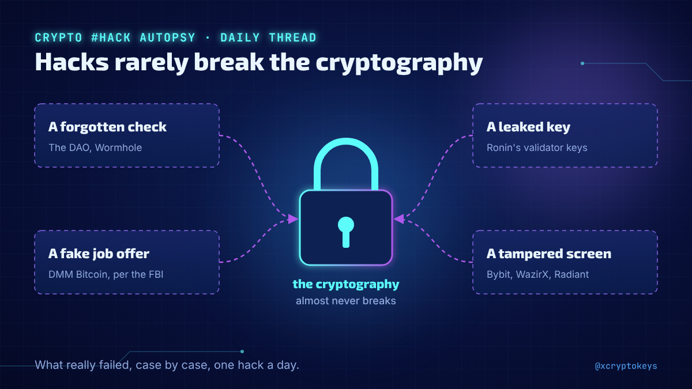

# Accroches hacks-001

Réponses à coller à la main sous un post populaire du même sujet, avec l'image qui va avec. Fichier généré par `design/card.py --hooks` depuis `hooks.json` : modifier le JSON, pas ce fichier. Règles dans `STYLE.md` (section Accroches).

## 1



```text
New daily thread dissecting the biggest crypto hacks: the DAO, Ronin, Wormhole, Bybit and more. Not how much was stolen, but the one line of code or the one key that failed. 52 heists, one a day. #XCKhak1
```

204 caractères

## 2



```text
The DAO paid out before updating its books. Ronin fell to one phished employee. Wormhole skipped one check and minted 120,000 wETH from nothing. I'm dissecting one crypto hack like this every day in a new thread. #XCKhak1
```

221 caractères

## 3



```text
How do you steal $1.5B from a cold wallet without ever stealing its keys? Bybit found out in February 2025. That's one of 52 crypto heists I'm taking apart, one a day, in a new thread. #XCKhak1
```

193 caractères

## 4



```text
From The DAO in 2016 to Ronin, Wormhole and Bybit: I started a daily thread retracing a decade of crypto heists, explained technically but readable without being a dev. #XCKhak1
```

177 caractères

## 5



```text
People think crypto hacks mean someone broke the cryptography. Almost never: it's a forgotten check, a leaked key, a fake job offer, a tampered screen. My new daily thread shows what really failed, case by case. #XCKhak1
```

220 caractères
