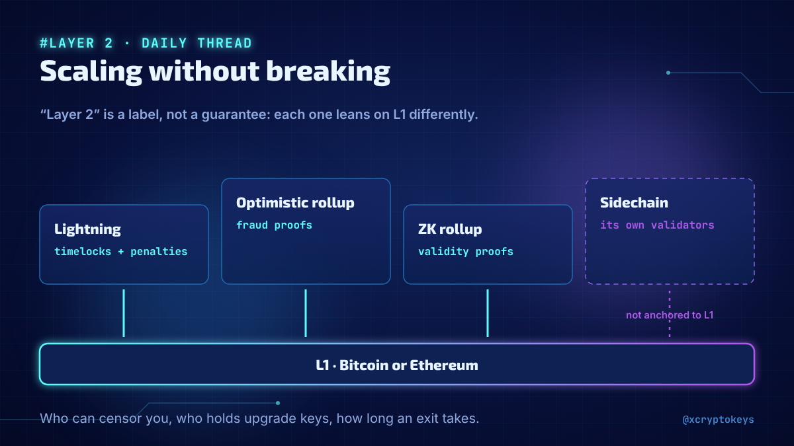
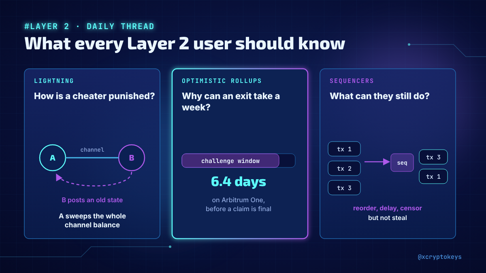
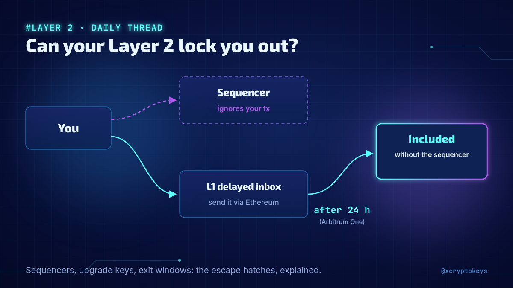
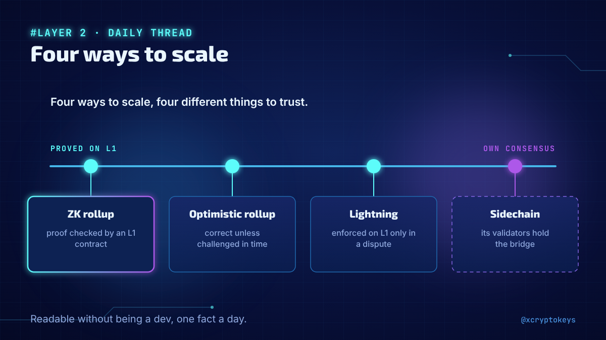
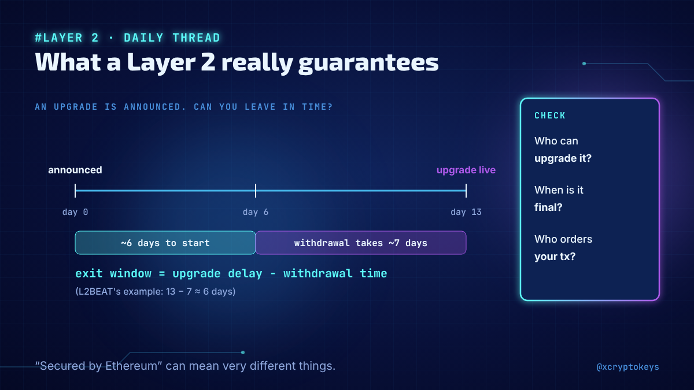

# Accroches layer2-001

Réponses à coller à la main sous un post populaire du même sujet, avec l'image qui va avec. Fichier généré par `design/card.py --hooks` depuis `hooks.json` : modifier le JSON, pas ce fichier. Règles dans `STYLE.md` (section Accroches).

## 1



```text
Layer 2 is a label, not a guarantee. New daily thread on what Lightning, rollups and sidechains really promise: who can censor you, who holds the upgrade keys, how long an exit takes. 67 posts, one a day. #XCKlay1
```

213 caractères

## 2



```text
How does Lightning punish a cheater? Why can leaving an optimistic rollup take a week? What is a sequencer still allowed to do? One question like this every day in my new Layer 2 thread. #XCKlay1
```

195 caractères

## 3



```text
Can a rollup's sequencer censor you? Can someone upgrade the contracts holding your funds? My new daily thread on Layer 2s answers questions like these, from Lightning to ZK rollups. #XCKlay1
```

191 caractères

## 4



```text
Lightning, sidechains, optimistic rollups, ZK rollups: they scale differently and trust different things. I started a daily thread comparing them one fact at a time, readable without being a dev. #XCKlay1
```

204 caractères

## 5



```text
'Secured by Ethereum' can mean very different things. I started a daily thread on what each Layer 2 really guarantees, what it doesn't, and how to check it yourself. #XCKlay1
```

174 caractères
