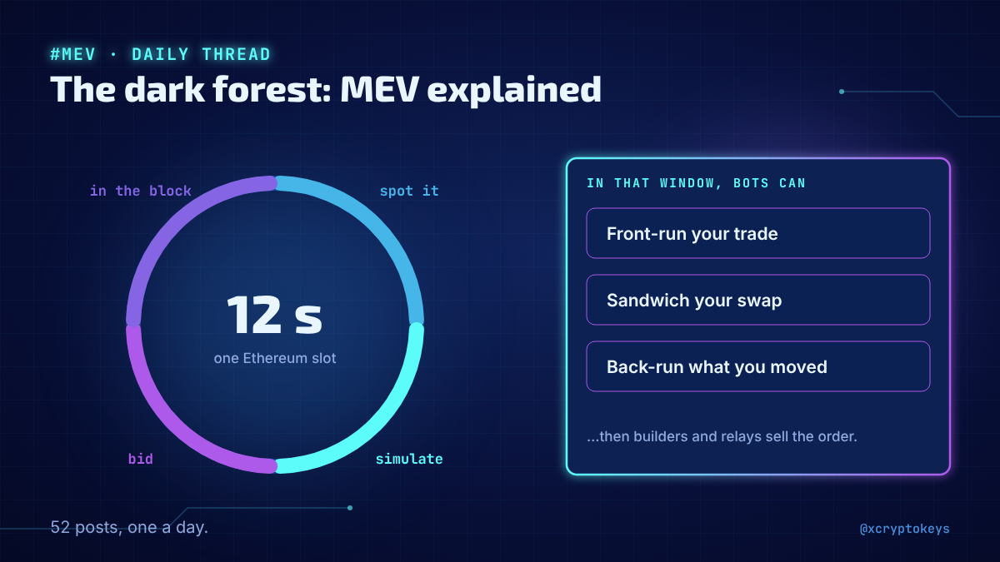
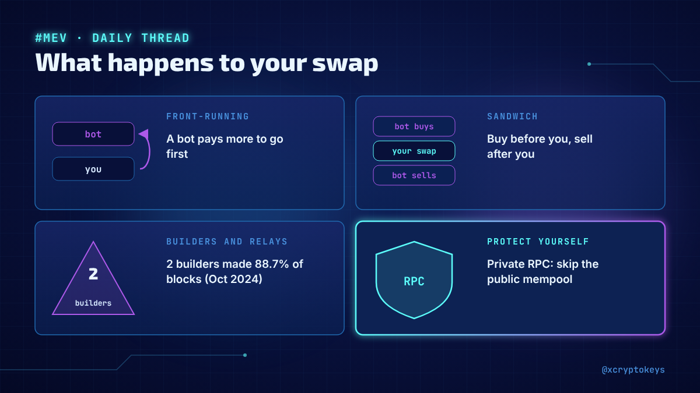
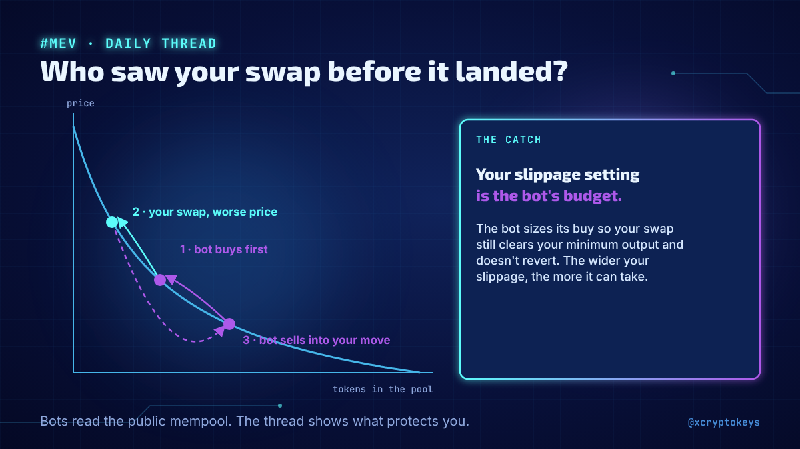
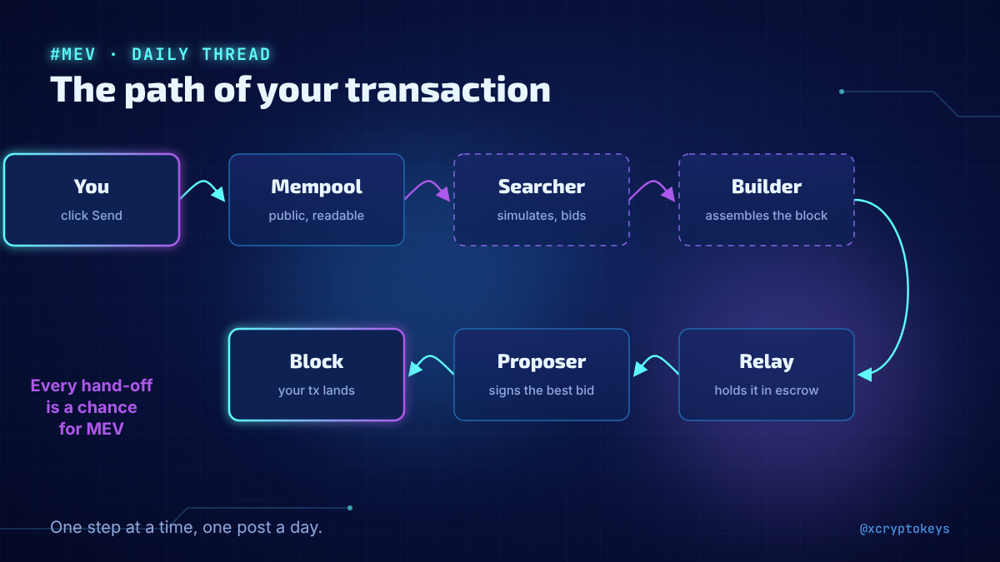
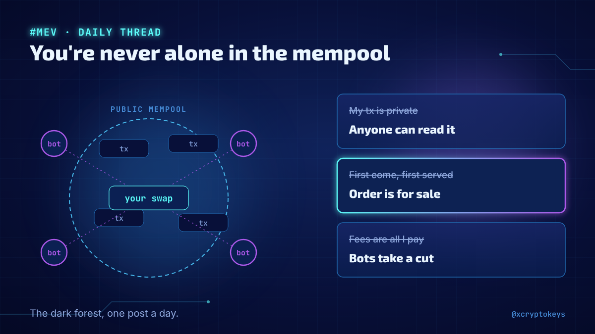

# Accroches mev-001

Réponses à coller à la main sous un post populaire du même sujet, avec l'image qui va avec. Fichier généré par `design/card.py --hooks` depuis `hooks.json` : modifier le JSON, pas ce fichier. Règles dans `STYLE.md` (section Accroches).

## 1



```text
What happens between clicking Send and your transaction landing in a block? Bots, builders, relays and sandwiches. New daily thread on MEV: who profits, how, and how to protect yourself. 52 posts. #XCKmev1
```

205 caractères

## 2



```text
Front-running, sandwich attacks, just-in-time liquidity, gas wars, private RPCs: I'm explaining the hidden market around every Ethereum transaction, one post a day, in a new thread. #XCKmev1
```

190 caractères

## 3



```text
Did you know your slippage setting is a bot's budget? Sandwich bots read pending swaps and squeeze them. My new daily thread on MEV explains how it works, and what actually protects you. #XCKmev1
```

195 caractères

## 4



```text
Send, mempool, searcher, builder, relay, proposer: your transaction passes through a lot of hands before it lands. I started a daily thread following that path, one step at a time. #XCKmev1
```

189 caractères

## 5



```text
Your pending transaction is public, its place in the block is for sale, and bots compete to profit from it. I'm explaining this dark forest one post a day in a new MEV thread. #XCKmev1
```

184 caractères
