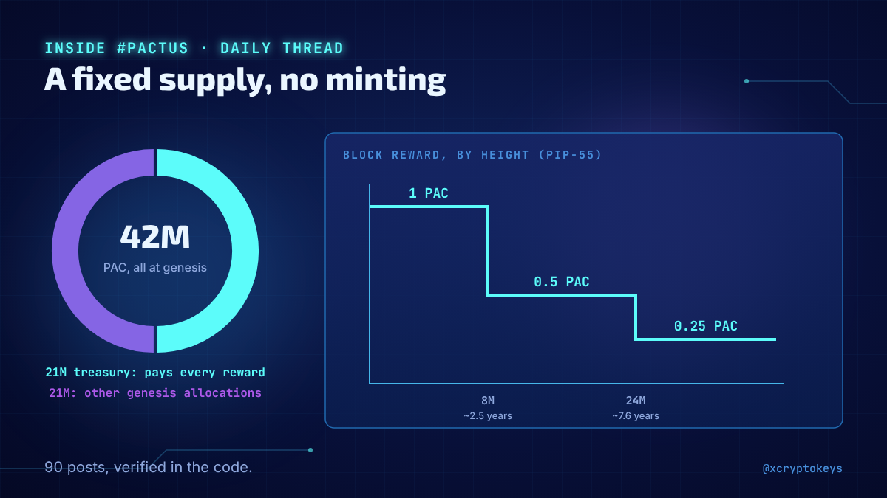
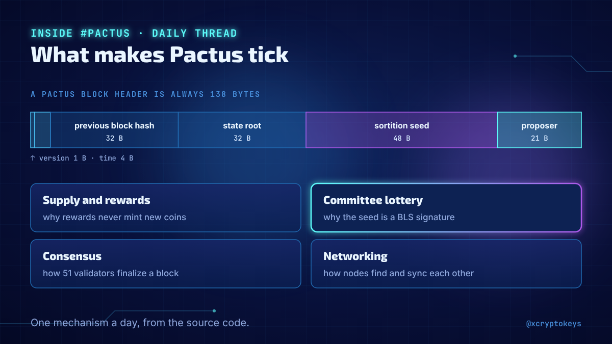
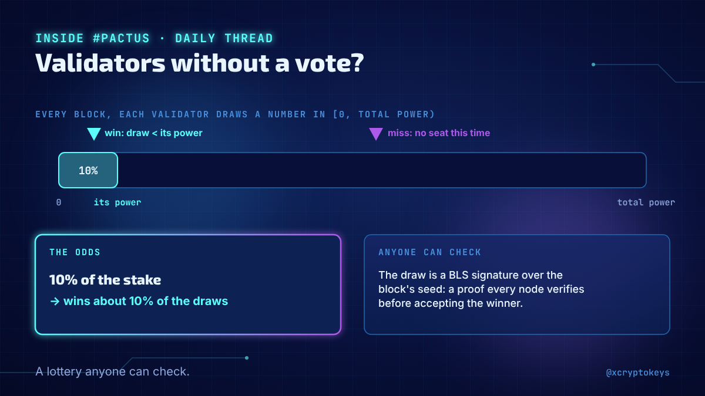
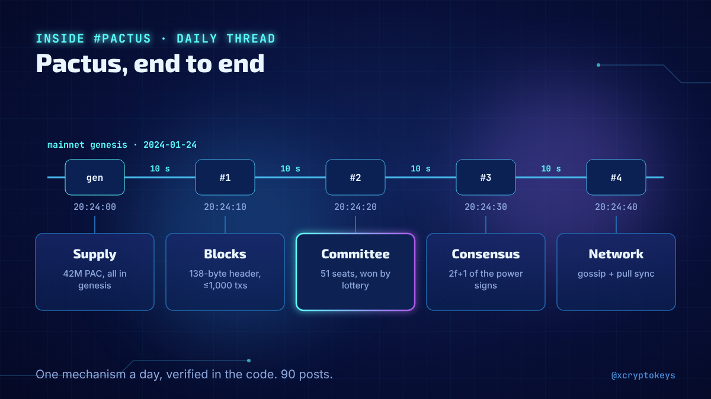
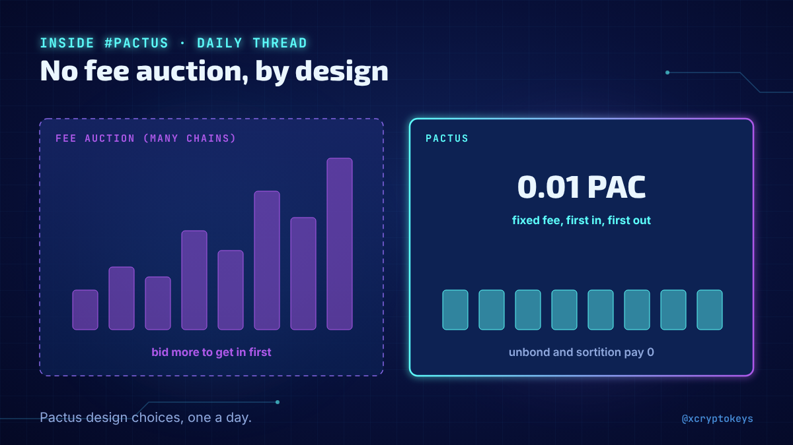

# Accroches pactus-001

Réponses à coller à la main sous un post populaire du même sujet, avec l'image qui va avec. Fichier généré par `design/card.py --hooks` depuis `hooks.json` : modifier le JSON, pas ce fichier. Règles dans `STYLE.md` (section Accroches).

## 1



```text
Daily thread on how Pactus works, checked against the code: a fixed 42M PAC supply, 10-second blocks, a lottery for the validator committee, flat fees with no auction. 90 posts, one a day. @PactusChain #XCKpac1
```

210 caractères

## 2



```text
How does Pactus pick validators without a vote? Why is there no chain ID? Why flat fees instead of an auction? I'm answering one question like these every day in a thread straight from the source code. #XCKpac1
```

210 caractères

## 3



```text
Pactus doesn't elect validators: after each block, every validator runs a private lottery for a committee seat, and anyone can check the draw. One of 90 posts in my daily Inside Pactus thread. #XCKpac1
```

201 caractères

## 4



```text
From the supply and block format to the committee lottery, staking, consensus, keys and networking: I'm going through Pactus one mechanism a day, verified in the code. 90 posts. #XCKpac1
```

186 caractères

## 5



```text
No fee auction, no inflation, no elected validators: Pactus does several things differently. I'm explaining each design choice in a daily thread, checked against the code. @PactusChain #XCKpac1
```

193 caractères
