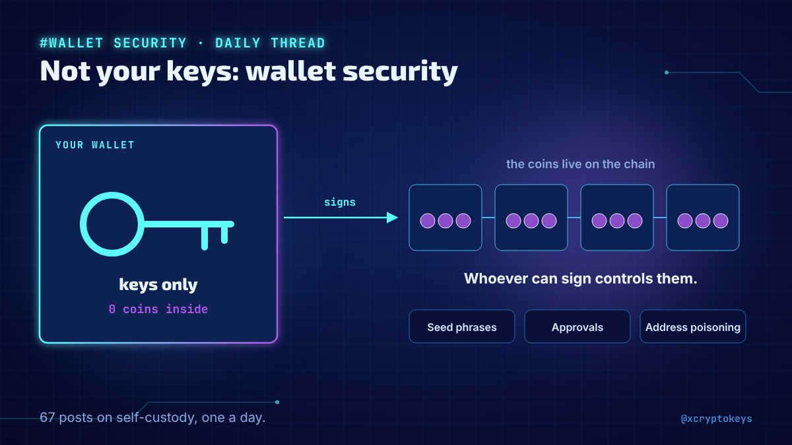
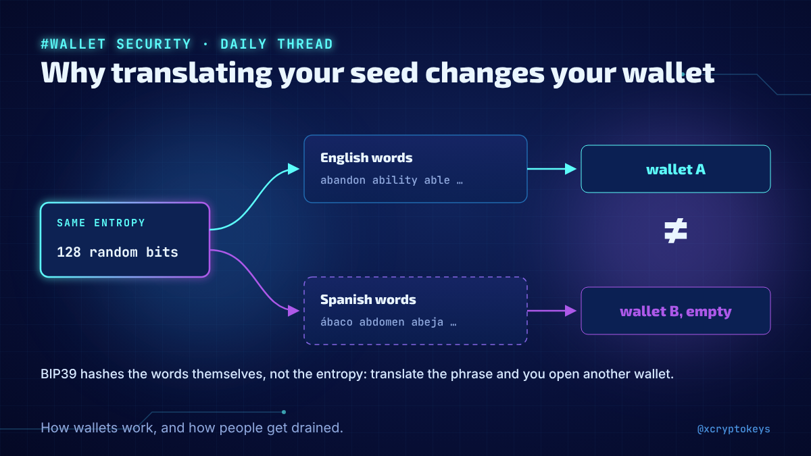
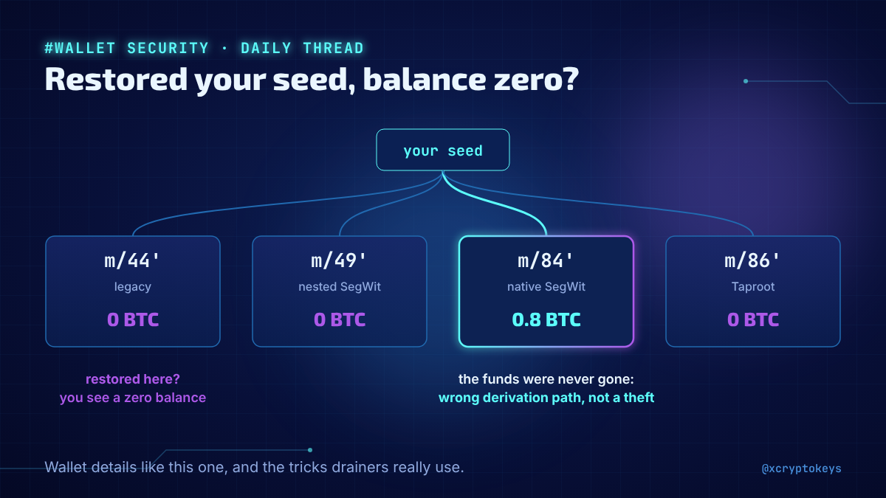
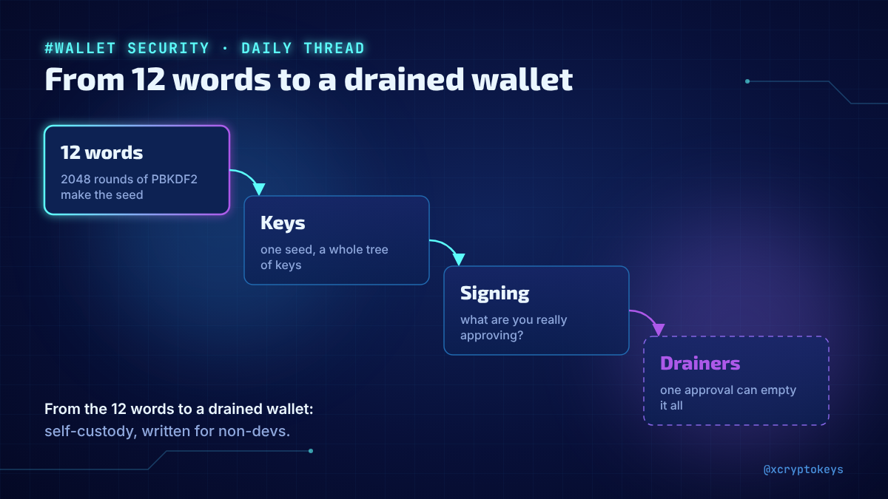
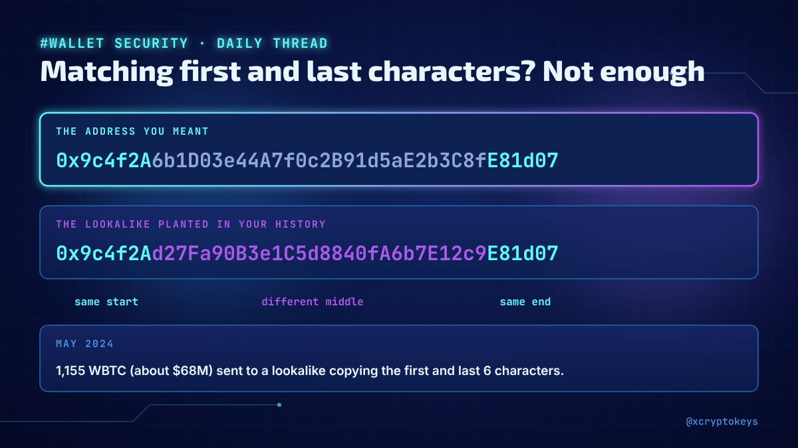

# Accroches wallets-001

Réponses à coller à la main sous un post populaire du même sujet, avec l'image qui va avec. Fichier généré par `design/card.py --hooks` depuis `hooks.json` : modifier le JSON, pas ce fichier. Règles dans `STYLE.md` (section Accroches).

## 1



```text
Your wallet holds keys, not coins. New daily thread on how wallets really work and how people get drained: seed phrases, hardware wallets, approvals, address poisoning. 67 posts, one a day. #XCKwal1
```

198 caractères

## 2



```text
Why can translating your seed change your wallet? Why does a restore sometimes show a zero balance? How does address poisoning work? One wallet security fact like these every day in my new thread. #XCKwal1
```

205 caractères

## 3



```text
Restored your seed and saw a zero balance? It's usually the derivation path, not a theft. My new daily thread covers wallet details like this one, and the tricks drainers actually use. #XCKwal1
```

193 caractères

## 4



```text
From the 12 words to the keys they create, to what you're really signing, to how drainers empty wallets: I started a daily thread on self-custody, written for non-devs. #XCKwal1
```

177 caractères

## 5



```text
Free to sign doesn't mean safe to sign. Checking the first and last characters isn't enough. I'm sharing one wallet security lesson like these every day in a new thread, drawn from real thefts. #XCKwal1
```

202 caractères
